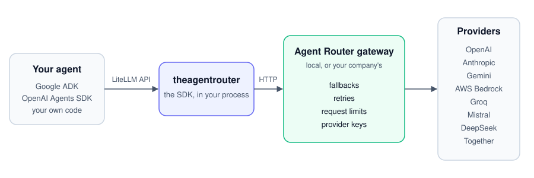

<h1 align="center">Agent Router Python SDK</h1>

<p align="center">
  Call AI models from your agent with LiteLLM's API.<br>
  Every call goes through <a href="https://github.com/theagentrouter/agent-router">Agent Router</a>, an open-source AI gateway, which handles fallbacks, retries and request limits.
</p>

<p align="center">
  <a href="https://github.com/theagentrouter/agent-router-python/actions/workflows/ci.yml"></a>
  <a href="https://pypi.org/project/theagentrouter/"></a>
  <a href="https://pypi.org/project/theagentrouter/"></a>
  <a href="LICENSE"></a>
</p>

<p align="center">
  
</p>

## Quick start

```sh
pip install theagentrouter
export ANTHROPIC_API_KEY=...
```

```python
import theagentrouter

resp = theagentrouter.completion(
    model="anthropic/claude-sonnet-5-5",
    messages=[{"role": "user", "content": "Summarise yesterday's refunds"}],
)
print(resp.choices[0].message.content)
```

OpenAI's Responses API, Anthropic's Messages API and embeddings work the same way, as in LiteLLM:

```python
resp = theagentrouter.responses(model="openai/gpt-4o-mini", input="Summarise yesterday's refunds")
print(resp.output_text)

resp = theagentrouter.anthropic.messages.create(
    model="anthropic/claude-sonnet-5-5",
    max_tokens=1024,
    messages=[{"role": "user", "content": "Summarise yesterday's refunds"}],
)
print(resp["content"][0]["text"])

vectors = theagentrouter.embedding(model="openai/text-embedding-3-small", input=["refunds", "returns"])
```

The first call starts a local gateway on your computer, and the gateway calls the provider with your key. On Windows, Intel Macs and older Linux there is no local gateway; use a remote one instead (see [Install](#install)).

## Why use it

- **Already using LiteLLM?** Change one import. Functions, arguments, responses and errors stay the same.
- **Fallbacks and retries run in a gateway, not in your process.** Define a route once, and every program on the computer uses it.
- **Google ADK and the OpenAI Agents SDK work without LiteLLM installed.**
- **Point it at your company's gateway with two environment variables.** Provider keys then stay on that gateway, not on laptops.

## Examples

| You want to | Example |
|---|---|
| Make one call | [`first_calls/one_call.py`](examples/first_calls/one_call.py) |
| Move a LiteLLM script over | [`from_litellm/change_the_import.py`](examples/from_litellm/change_the_import.py) |
| Fall back to another model when one fails | [`routes/fallback.py`](examples/routes/fallback.py) |
| Retry on rate limits and server errors | [`routes/retry.py`](examples/routes/retry.py) |
| Stream, use tools, get JSON back | [`first_calls/stream.py`](examples/first_calls/stream.py), [`first_calls/tools.py`](examples/first_calls/tools.py), [`first_calls/json_schema.py`](examples/first_calls/json_schema.py) |
| Use OpenAI's Responses API or Anthropic's Messages API | [`provider_apis/openai_responses.py`](examples/provider_apis/openai_responses.py), [`provider_apis/anthropic_messages.py`](examples/provider_apis/anthropic_messages.py) |
| Run a Google ADK or OpenAI Agents SDK agent | [`agent_frameworks/google_adk.py`](examples/agent_frameworks/google_adk.py), [`agent_frameworks/openai_agents.py`](examples/agent_frameworks/openai_agents.py) |
| Send calls to your company's gateway | [`gateways/your_gateway.py`](examples/gateways/your_gateway.py) |

All twenty-three, with the keys each one needs: [examples/](examples/README.md).

## Coming from LiteLLM

```python
from theagentrouter.compat import litellm   # was: import litellm
```

Change this one import; the rest of your code stays the same. Some LiteLLM functions are not in the SDK, and some arguments are ignored with a warning. The full list: [docs/coming-from-litellm.md](docs/coming-from-litellm.md).

## Fallbacks and retries

A route is a model name you choose, with the models behind it in order. The local gateway calls the first model, retries it if it fails, then moves on to the next one:

```python
import theagentrouter as ar

ar.route("chat", primary="openai/gpt-4o", fallbacks=["anthropic/claude-sonnet-5-5"], retry=ar.Retry(attempts=2))
ar.completion(model="chat", messages=[{"role": "user", "content": "hi"}])
```

Here a call to `chat` goes to `openai/gpt-4o`. If it cannot be reached or answers with 429, 500, 502, 503 or 504, the gateway retries it up to 2 more times, then tries `anthropic/claude-sonnet-5-5` the same way. Other errors, such as 401, are not retried.

- A route can also limit requests: `limit=ar.Limit(60, per="minute")` lets 60 requests a minute through and answers the rest with a `RateLimitError`.
- Routes are saved in `~/.agentrouter/routes.json`, so every program on this computer can use them.
- Routes work with the local gateway only. With `AGENTROUTER_BASE_URL` set, set up fallbacks on that gateway instead.
- `Router` from `theagentrouter.compat.litellm`, with LiteLLM's `fallbacks` and `num_retries`, is turned into routes.

Details: [Routes](docs/usage.md#routes-fallbacks-retries-and-names-of-your-own).

## Agent frameworks

| Framework | How |
|---|---|
| Google ADK | `install_as_litellm()`, then ADK's `LiteLlm` model |
| OpenAI Agents SDK | `install_as_litellm()`, then the Agents SDK's `LitellmModel` |

`install_as_litellm()` is in `theagentrouter.compat`. It makes `import litellm` load this SDK, so neither framework needs LiteLLM installed. Details and examples: [docs/frameworks.md](docs/frameworks.md).

## Install

```sh
pip install theagentrouter
```

This installs the SDK and the local gateway. The local gateway is Agent Router's `aigw` program, about 80 MB, and it runs on:

- macOS 13 or newer on Apple chips
- Linux with glibc 2.36 or newer, on x86-64 or Arm

On any other computer (Windows, Intel Macs, macOS 12 or older, Alpine Linux, Linux with glibc older than 2.36) there is no local gateway, so the same command installs the SDK alone. Calls then need a remote gateway (below).

If your code will use a remote gateway, for example on a server, in a container, in a serverless function or in CI, install the SDK alone and skip the 80 MB:

```sh
pip install theagentrouter-core
```

Both packages are imported the same way: `import theagentrouter`.

**Using a remote gateway.** To send calls to an Agent Router gateway that your team or company runs, set its address and key:

```sh
export AGENTROUTER_BASE_URL=https://gateway.acme.example/v1
export AGENTROUTER_API_KEY=...
```

With these set, calls go to that gateway, the local gateway never starts, and the provider keys stay on the remote gateway. This works on every computer.

**The local gateway keeps running** after your program ends, and every program on this computer that uses the SDK shares it. Its files are in `~/.agentrouter/local-gateway/` (or `AGENTROUTER_HOME/local-gateway/`): `config.yaml`, `state.json` and `aigw.log`. To stop it (the next call starts it again):

```sh
python -c "from theagentrouter import local_gateway; local_gateway.stop()"
```

Installing from source, checking the install, upgrading and removing: [docs/install.md](docs/install.md).

## Documentation

| Page | What it covers |
|---|---|
| [Install](docs/install.md) | The SDK, the local gateway, checking it works, upgrading, removing |
| [Usage](docs/usage.md) | Models and keys, parameters, streaming, async, tools, the Responses API, the Messages API, embeddings, errors, cost, gateways, settings |
| [Coming from LiteLLM](docs/coming-from-litellm.md) | What works the same, what is missing, what is ignored, a checklist |
| [Agent frameworks](docs/frameworks.md) | Google ADK and the OpenAI Agents SDK |
| [How the local gateway works](docs/local-gateway.md) | For contributors: packages, config, routing, tests, what is open |

## For coding agents

- [`skills/`](skills/): agent skills (`SKILL.md`). [`migrate-from-litellm`](skills/migrate-from-litellm/SKILL.md) moves a project off LiteLLM; [`theagentrouter`](skills/theagentrouter/SKILL.md) writes new code with the SDK. Copy a folder into your agent's skills folder (for Claude Code, `.claude/skills/`), then ask it to "migrate this project from LiteLLM to theagentrouter".

## More

- [DEVELOPMENT.md](DEVELOPMENT.md): what is where in this repository, setting up, tests, the framework tests, real-provider checks, releases.
- [CONTRIBUTING.md](CONTRIBUTING.md), [SECURITY.md](SECURITY.md), [CHANGELOG.md](CHANGELOG.md).

## Design

1. **Only what agent frameworks use.** The SDK has a LiteLLM function or setting only if an agent framework calls it. So there is no image generation, speech, video, files or batches.
2. **Agent Router handles the calls.** The gateway does fallbacks, retries, request limits, provider keys and logging. The SDK only does what a gateway can't, like building LiteLLM's response objects or running your callbacks.
3. **Same API as LiteLLM.** Same function names, arguments, responses and errors.

## License

[Apache License 2.0](LICENSE).
